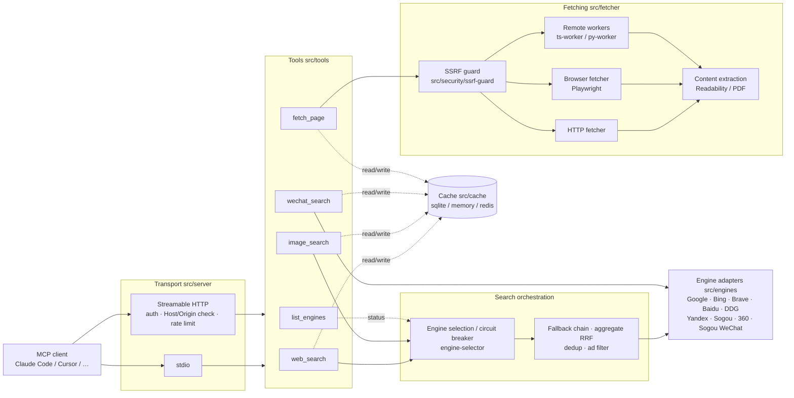

<p align="center">
  
</p>

<h1 align="center">PrismSearch</h1>

<p align="center">
  <a href="https://github.com/xiaonerner0821/prismsearch/actions/workflows/ci.yml"></a>
  <a href="https://www.npmjs.com/package/prismsearch"></a>
  <a href="https://codecov.io/gh/xiaonerner0821/prismsearch"></a>
  <a href="https://github.com/xiaonerner0821/prismsearch/actions/workflows/codeql.yml"></a>
  <a href="https://scorecard.dev/viewer/?uri=github.com/xiaonerner0821/prismsearch"></a>
  <a href="https://nodejs.org"></a>
  <a href="LICENSE"></a>
</p>

<p align="center"><strong><a href="README.zh-CN.md">简体中文</a></strong> | English</p>

A multi-engine web search MCP (Model Context Protocol) server that aggregates search results from multiple search engines.

Like a prism splits light into a spectrum, PrismSearch disperses your search queries across multiple engines for multi-perspective results.

### Why: web search for your AI agent, no search account required

The built-in web search of AI coding agents such as Claude Code and DeepSeek Harness usually depends on an official account or a separately configured search API key. Use a third-party model, go through your own gateway, or simply skip the search account, and the built-in search is often unavailable — the agent ends up coding "closed-book".

PrismSearch adds that capability back with one command:

- **No account, no API key out of the box**: the default engines (Bing, Baidu, …) scrape public result pages, so there is nothing to sign up for. Enable browser fetching (`fetcher.browser.enabled: true`, requires Playwright) and Google works without a key too. Brave / Google API keys are picked up automatically when present for extra reliability
- **Any model, any client**: plain MCP — works with Claude Code, DeepSeek Harness, Cursor, VS Code, Cline and any other MCP-capable client
- **More than search**: `fetch_page` reads web pages and PDFs (Markdown output, paginated for long documents), `wechat_search` searches WeChat Official Account articles — the "found it, now read it" half
- **Works behind restrictive networks**: Chinese sources (Baidu, Sogou, 360, WeChat) work out of the box; when an engine is blocked or rate-limited the request falls back to the next one automatically
- **Clean results**: sponsored results injected by search engines are removed — see "Ad filtering" below

```bash
# Claude Code
claude mcp add prismsearch -- npx -y prismsearch
```

<p align="center">
  
</p>

> [!WARNING]
> Scraping engines fetch results from public web pages. You are responsible for complying with each search engine's and target site's terms of service, robots policies and local laws, and for keeping request rates reasonable.
> The learning/research recommendation is not an additional restriction on the Apache-2.0 license. This project is not affiliated with any search engine company. See the full [Disclaimer](#disclaimer) at the end.

## Features

- **9 Search Sources**: Google, Bing, Baidu, Brave, DuckDuckGo, Yandex, Sogou, 360 Search, plus WeChat Official Account articles — with an extensible engine plugin system
- **5 MCP Tools**: `web_search`, `image_search`, `fetch_page`, `wechat_search`, `list_engines`
- **Dual Transport**: stdio (local) and Streamable HTTP (remote) MCP transport
- **Smart Engine Selection**: Auto-selects the best engine based on availability, latency, success rate, and language matching, with cross-engine fallback
- **Google Triple Strategy**: Custom Search API → browser rendering → plain HTTP, with automatic fallback and sticky success memory
- **Ad Filtering**: Baidu promotions, Bing / Google / DuckDuckGo sponsored results and 360 / Sogou paid slots are dropped and don't eat into the requested count; anything that slips through is filtered again by its landing URL (paid-click tracking parameters)
- **Web Page Fetching**: Fetch and extract content from URLs in HTML, plain text, or Markdown; optional Playwright rendering for JS-heavy pages
- **Image Search**: Multi-engine image search with size/type filters and optional base64 thumbnails
- **Caching**: Configurable TTL and LRU eviction with pluggable backends — `cache.backend: sqlite | memory | redis` (SQLite by default)
- **Security**: SSRF protection, rate limiting, domain whitelist/blacklist, optional Bearer auth for remote mode
- **Hot Reload**: Configuration file watching with automatic reload
- **Flexible Config**: YAML/JSON/TOML configuration with environment variable overrides

### Example

A single `web_search` call returns structured, deduplicated results:

```json
{
  "results": [
    {
      "title": "Model Context Protocol - Introduction",
      "url": "https://modelcontextprotocol.io/introduction",
      "snippet": "The Model Context Protocol (MCP) is an open protocol that enables seamless integration between LLM applications and external data sources and tools.",
      "source": "brave",
      "position": 1
    }
  ],
  "totalResults": 10,
  "engine": "brave",
  "searchTime": 842,
  "cached": false,
  "page": 1,
  "hasMore": true
}
```

Every item in `results[]` always has `title`, `url`, `snippet`, `source` (the engine) and `position`, and may have `timestamp`; with `mode=aggregate` items also carry `sources` and the response carries `engines`. When the engine ignored some parameters the response carries `warnings`. The same JSON is returned both as `structuredContent` and as text in `content`.

### Architecture



In stdio mode there is a single client, so rate limiting happens at the tool layer; in HTTP mode the transport rate-limits per client. Whether `fetch_page` is delegated to a worker is controlled by `workers.useFor`; when no worker is available it falls back to the local fetchers, and the final URL returned by a worker is SSRF-checked again.

## Requirements

- **Node.js ≥ 22.19**
- Native module `better-sqlite3` ships prebuilt binaries for mainstream platforms (Windows/macOS/Linux, x64/arm64); if prebuilds are unavailable on your platform, a C++ build toolchain is required
- **Optional**: [Playwright](https://playwright.dev) for browser rendering. It is an `optionalDependency` — installed by default (browsers download on install); use `npm install --omit=optional` for a minimal install. To add it later: `npm install playwright && npx playwright install chromium`

## Quick Start

### Installation

```bash
npm install prismsearch
```

### Usage with Claude Code

```bash
claude mcp add prismsearch -- npx -y prismsearch
```

Or add to your MCP settings:

```json
{
  "mcpServers": {
    "prismsearch": {
      "command": "npx",
      "args": ["-y", "prismsearch"],
      "env": { "BRAVE_API_KEY": "optional" }
    }
  }
}
```

### Other clients

| Client | Config location | Notes |
| --- | --- | --- |
| Claude Desktop | `claude_desktop_config.json` | Same `mcpServers` snippet |
| Cursor | `~/.cursor/mcp.json` or `.cursor/mcp.json` | Same `mcpServers` snippet |
| VS Code (Copilot) | `.vscode/mcp.json` | Top-level key is `servers`; add `"type": "stdio"` |
| Windsurf / Cline etc. | Their own MCP config | Generic `command` + `args` form |
| Remote (HTTP) | Any Streamable HTTP client | URL `http://host:3000/mcp`, header `Authorization: Bearer <token>` |

On Windows, if the client cannot find `npx`, set `command` to `"cmd"` and `args` to `["/c", "npx", "-y", "prismsearch"]`.

### Use as an Agent Skill

[`skills/prismsearch/SKILL.md`](skills/prismsearch/SKILL.md) is an [Agent Skill](https://agentskills.io) that teaches the agent when to use each tool: search first and then read the source pages, use `timeRange` / `aggregate` mode, fall back to browser rendering, page through long documents, and handle engine failures. The MCP server above still has to be connected; the skill only adds usage guidance.

To install it for Claude Code, copy the folder into your skills directory:

```bash
# All projects
cp -r skills/prismsearch ~/.claude/skills/
# Current project only
cp -r skills/prismsearch .claude/skills/
```

Other agents that support the Agent Skills format can load the same folder.

### Engine capabilities

| Engine | Web | Image | Method | Default | Notes |
| --- | --- | --- | --- | --- | --- |
| Google | ✅ | ✅ | API / browser / HTTP | on | Custom Search API is the most reliable; plain HTTP usually hits the JS wall |
| Bing | ✅ | ✅ | HTTP scraping | on | |
| Brave | ✅ | ✅ | Official API | on | Needs `BRAVE_API_KEY`; skipped when absent |
| Baidu | ✅ | ✅ | HTTP scraping / JSON API | on | Chinese content |
| DuckDuckGo | ✅ | — | HTTP scraping | off | Frequent requests trigger a bot challenge |
| Yandex | ✅ | — | HTTP scraping | off | |
| Sogou | ✅ | — | HTTP scraping | off | Chinese content |
| 360 Search | ✅ | — | HTTP scraping | off | Chinese content |

#### Parameter support per engine (web search)

How each `web_search` parameter is translated for each engine. "—" means the engine has no equivalent; the parameter is accepted but ignored, and the response's `warnings` lists which parameters were dropped. `list_engines` also declares per-engine support in its `capabilities` field.

| Engine | `region` | `language` | `safeSearch` | `timeRange` | `page` | `count` |
| --- | --- | --- | --- | --- | --- | --- |
| Google (scrape) | `gl` | `hl` | `safe=active` | `tbs=qdr:d/w/m/y` | `start` offset | `num` |
| Google (Custom Search API) | `gl` | `hl` | `safe=active/off` | `dateRestrict` | `start` offset, max 100 results total | 10 per request; larger counts fetch several pages |
| Bing | `cc` (country, `uk` → `GB`) + `mkt` (market) | `setlang` | `adlt=strict` | `filters=ex1:"ez1/ez2/ez3"`, custom range for year | `first` offset (advanced by results actually returned) | ~10 per page; larger counts stitch several pages |
| Brave | `country` (`uk` → `GB`) | `search_lang` | `safesearch=strict/moderate` | `freshness=pd/pw/pm/py` | `offset`, max 10 pages | up to 20 per request; larger counts fetch several pages |
| Baidu | — | — | — | `gpc=stf=…` (time range) | `pn` offset | `rn` |
| DuckDuckGo | `kl` (region + language, e.g. `us-en`) | used for `kl` / `Accept-Language` | `kp=1` | `df=d/w/m/y` | `s` offset | truncated client-side |
| Yandex | `lr` (region ID) | `lang` | — | — | `p` (0-based) | `numdoc` |
| Sogou | — | — | — | `s_from=inttime_*` | `page` | fixed 10 per page, truncated client-side |
| 360 Search | — | — | — | `adv_t=d/w/m/y` | `pn` | fixed 10 per page, truncated client-side |

Image search: Google (`gl` / `hl` / `safe`, size and type via `tbs`), Bing (`setlang`, `safesearch=strict`, size and type via `qft`), Brave (`country` / `search_lang` / `safesearch`; the API has no paging, so pages are sliced from up to 200 results), Baidu (size via `z`, GIF via `ic`; no region / language / safe search).

On page 1 the server over-fetches a few extra results so that de-duplication still fills `count`; later pages of an auto-selected search stick to the engine that served page 1 so results don't jump between engines.

WeChat articles are a separate `wechat` config section (not a regular engine) served by the `wechat_search` tool; returned links expire.

Scraping engines depend on page structure and may break briefly when a search engine redesigns; the project runs a daily live smoke test to catch that early.

### Usage with HTTP Transport

```bash
# Start with the bundled HTTP example config
npx prismsearch config/http.yaml

# Or use environment variables
PRISMSEARCH_SERVER_TRANSPORT=http PRISMSEARCH_SERVER_PORT=3000 npx prismsearch
```

The HTTP endpoint is `http://127.0.0.1:3000/mcp` (health check at `/health`). When exposing it beyond localhost, always enable auth: set `PRISMSEARCH_AUTH_TOKENS` or enable `security.auth` in your config.

### CLI

```bash
prismsearch [config-file]  # start the server; the optional positional argument is a config file (YAML / JSON / TOML)
prismsearch --help         # bilingual (English / Chinese) help including common environment variables (-h)
prismsearch --version      # print the version (-v)
```

The positional argument has the highest priority, above `PRISMSEARCH_CONFIG` and the default search paths (see "Configuration"). If the given file does not exist, the server exits with an error. Transport, port, etc. are not CLI flags — set them in the config file or via environment variables (see "Environment variables"). The CLI is intentionally a thin launcher: it does not provide a browser UI, hosted search account, or separate web dashboard; use an MCP-capable client (or the HTTP transport) to call the tools.

The npm package ships only this CLI / MCP server; it is not a JavaScript library. Do not `import 'prismsearch'` or deep-import files under `dist/` — importing the entry point starts a server, and internal modules may change in any release. The stable, versioned interfaces are the MCP tool schemas, the configuration file, and the [Worker protocol](docs/worker-protocol.md); to extend fetching, implement a Worker, and to add engines, contribute upstream or fork.

### Privacy and local data

PrismSearch does not provide a hosted data service. In the default local stdio setup, requests and responses pass through the local process; cache entries are stored locally (SQLite by default) and logs go to the local process' stderr. If you enable remote HTTP transport, third-party API keys, browser fetching, proxies, Redis, or Workers, query text, URLs, headers, and fetched content may be sent to those providers or services. Review their privacy policies and configure retention, access controls, and `log.redact` for your deployment. Do not submit passwords, private tokens, personal data, or confidential content unless you have verified every service in the path.

### Terms, copyright, and service access

Search snippets, images, pages, PDFs, and WeChat articles are supplied by third parties and may be protected by copyright or other rights. PrismSearch does not grant rights to copy, store, display, scrape, or redistribute third-party content. You are responsible for permission, attribution, robots directives, applicable law, and each provider's terms and rate limits. The Apache-2.0 license covers this repository's code only; it does not grant access to any search service, bypass authentication or anti-bot controls, or license third-party trademarks/content.

## MCP Tools

### web_search

Search the web using multiple search engines (Google, Bing, Baidu, 360, Sogou, DuckDuckGo, Yandex, Brave).

**Parameters:**
| Parameter | Type | Required | Default | Description |
|-----------|------|----------|---------|-------------|
| query | string | Yes | - | Search keywords, 1-500 characters after trimming |
| engine | string | No | auto | Engine: `google`, `bing`, `baidu`, `so`, `sogou`, `duckduckgo`, `yandex`, `brave`; auto-selected with fallback when omitted |
| region | string | No | - | Region code (e.g., `cn`, `us`, `hk`), max 10 characters |
| language | string | No | - | Language code (e.g., `zh-CN`, `en`), max 20 characters |
| count | integer | No | 10 | Number of results, 1-50 |
| page | integer | No | 1 | Page number, 1-10 |
| safeSearch | boolean | No | false | Enable safe search |
| timeRange | string | No | - | Time filter: `day`, `week`, `month`, `year`; auto-selection prefers engines that support it |
| mode | string | No | fallback | `fallback`: one engine, falling back on failure; `aggregate`: query the top 3 available engines concurrently and merge with Reciprocal Rank Fusion (deduplicated, results carry `sources`, response carries `engines`) |

When the client passes `_meta.progressToken`, the server sends `notifications/progress` each time an engine is tried / started.

### image_search

Search for images using multiple search engines (Google, Bing, Baidu, Brave).

**Parameters:**
| Parameter | Type | Required | Default | Description |
|-----------|------|----------|---------|-------------|
| query | string | Yes | - | Search keywords, 1-500 characters after trimming |
| engine | string | No | auto | Image-capable engine: `google`, `bing`, `brave`, `baidu`; auto-selected with fallback when omitted |
| region | string | No | - | Region code, max 10 characters |
| language | string | No | - | Language code, max 20 characters |
| count | integer | No | 10 | Number of results, 1-50 |
| page | integer | No | 1 | Page number, 1-10 |
| safeSearch | boolean | No | false | Enable safe search |
| imageSize | string | No | - | Filter by size: `small`, `medium`, `large` |
| imageType | string | No | - | Filter by type: `photo`, `clipart`, `gif`, `transparent` |
| includeThumbnails | boolean | No | false | Inline base64 thumbnails in results (max 20, 50KB each) |

Each result has `title`, `imageUrl`, `thumbnailUrl`, `sourceUrl`, `position` and `source`, and may have `sourceTitle`, `width`, `height` and `thumbnailBase64`; the response also carries `engine`, `searchTime`, `cached`, `page` and `hasMore`.

### fetch_page

Fetch and extract content from a webpage URL.

**Parameters:**
| Parameter | Type | Required | Default | Description |
|-----------|------|----------|---------|-------------|
| url | string | Yes | - | URL to fetch, http/https only, max 4096 characters |
| format | string | No | markdown | Output format: `html`, `text`, `markdown` |
| timeout | integer | No | 30000 (`fetcher.timeout`) | Total timeout in milliseconds, 1000-120000, shared by all fallback / re-fetch attempts |
| method | string | No | http (`fetcher.defaultMethod`) | Fetch method: `http` or `browser` (Playwright, for JS-rendered pages). When omitted, an `http` result that looks like a JS skeleton or anti-bot challenge page is re-fetched with the browser (if available). Explicit `http` never upgrades; `browser` falls back to `http` with a warning when Playwright is unavailable |
| waitForSelector | string | No | - | Browser only: CSS selector to wait for before extracting, max 500 characters; if it never appears, the content rendered so far is returned |
| maxLength | integer | No | 20000 | Max characters of content returned per call, 100-1000000; when exceeded the result has `truncated: true` and `nextStartIndex` |
| startIndex | integer | No | 0 | Character offset to start from (≥ 0); use `nextStartIndex` to read the rest (served from the same cache entry, no re-fetch) |

`totalLength` is the full content length; `bodyTruncated` means the response body exceeded `fetcher.maxBytes` and only its beginning was fetched. With `format=html` the HTML is returned once, in `content`.

Main-content extraction uses Mozilla Readability first (`@mozilla/readability` + `linkedom`) and falls back to the built-in heuristics. PDFs have their text layer extracted (`unpdf`, first 50 pages); scanned PDFs without a text layer produce a warning. Every target URL is checked by the SSRF guard first (see "Security").

### wechat_search

Search WeChat Official Account (微信公众号) articles via Sogou WeChat search. Returns article titles, account names, publish dates, snippets, and signed temporary article URLs.

**Notes:**
- Article URLs are **signed and time-limited** (typically valid for a few hours) — use `fetch_page` promptly to retrieve full content.
- Results are cached for 10 minutes only (shorter than web search, due to URL expiry).
- Sogou applies rate limiting; the engine automatically rotates cookies and retries with backoff.

**Parameters:**
| Parameter | Type | Required | Default | Description |
|-----------|------|----------|---------|-------------|
| query | string | Yes | - | Search keywords (Chinese works best), 1-200 characters after trimming |
| count | integer | No | 10 | Number of results, 1-10 |
| page | integer | No | 1 | Page number, 1-10 |

### list_engines

List all registered search engines and their current status, including availability, latency, and supported features. No parameters.

## Configuration

PrismSearch uses the first configuration file it finds, in this order:
1. Path passed as the command-line argument (`npx prismsearch ./my-config.yaml`)
2. The `PRISMSEARCH_CONFIG` environment variable
3. `./prismsearch.{yaml,yml,json,toml}` in the current working directory
4. `~/.prismsearch/config.{yaml,yml,json,toml}` (the directory follows `PRISMSEARCH_HOME` if set)

If no file is found, built-in defaults are used. Environment variables are applied on top of whichever source wins.

[config/default.yaml](config/default.yaml) is the annotated reference for every option. It is **not** loaded automatically — copy it to one of the locations above (or point `PRISMSEARCH_CONFIG` at it) and keep only the keys you want to change.

**Enabling more engines:** Only Google, Bing, Brave and Baidu are enabled by default. DuckDuckGo, Yandex, Sogou and 360 Search are listed in [config/default.yaml](config/default.yaml) with `enabled: false` — set it to `true` in your own config (or e.g. `PRISMSEARCH_ENGINES__DUCKDUCKGO__ENABLED=true`).

**Search deadline:** `search.deadlineMs` (default `45000`) caps the total time of one `web_search` / `image_search` call across the whole fallback chain; once it is reached no further engines are tried, so a client is never left hanging while several engines time out one after another. Cancelling the MCP request also aborts the upstream requests in flight.

**Ad filtering:** two layers. (1) While parsing, each engine skips results carrying ad markers (sponsored labels, ad-only classes / attributes, ad regions) — always on. (2) The tool layer drops remaining results whose landing URL looks like an ad (ad-click redirect hosts, and paid tracking parameters such as `sdclkid`, `gclid`, `msclkid`, `utm_medium=cpc/ppc/sem`). Layer (2) can be turned off with `search.adFilter: false` (or `PRISMSEARCH_SEARCH__ADFILTER=false`). Baidu's own vertical cards (e.g. 爱采购 / 惠生活) are not ads and are kept.

**Engine affinity:** when a request carries `region` / `language`, the selector prefers engines that are good at that region / language. Each engine can override the built-in defaults with `regions` and `languages` (e.g. Baidu defaults to `cn/hk/tw` and Chinese languages); leave them empty to keep the built-ins, or set them to replace the built-ins entirely. Region matching is case-insensitive.

### Google Search Setup

Since 2025, Google requires JavaScript rendering for its search result pages — plain HTTP
scraping only receives an "enable JavaScript" interstitial. PrismSearch's Google engine
supports three strategies, tried in order with automatic fallback and sticky success
memory: **Custom Search API → browser rendering → plain HTTP**.

**Option A: Browser rendering (Playwright)**

```bash
npm install playwright
npx playwright install chromium
```

Then enable the browser fetcher in your config:

```yaml
fetcher:
  browser:
    enabled: true
    browserType: chromium
```

**Option B: Google Custom Search API (recommended, most stable)**

Free quota: 100 queries/day per API key. Requires two credentials:

| Credential | Config field | Environment variable |
|------------|--------------|----------------------|
| API Key | `engines[].apiKey` (comma-separated for rotation) | `GOOGLE_API_KEY` |
| Search Engine ID (cx) | `engines[].searchEngineId` | `GOOGLE_CSE_ID` |

How to get them:

1. Open [Google Cloud Console](https://console.cloud.google.com/) and create/select a project.
2. Go to **APIs & Services → Library**, search for **Custom Search API**, click **Enable**.
3. Go to **APIs & Services → Credentials → Create Credentials → API key**.
   (Recommended: restrict the key to "Custom Search API".)
4. Open [Programmable Search Engine](https://programmablesearchengine.google.com/),
   click **Add**, choose **Search the entire web**, and copy the **Search engine ID** (cx).
5. Set the credentials via environment variables (**recommended — never commit keys to git**):

```bash
# Windows (persistent)
setx GOOGLE_API_KEY "AIza..."
setx GOOGLE_CSE_ID "0123456789abcdef0"

# macOS / Linux
export GOOGLE_API_KEY="AIza..."
export GOOGLE_CSE_ID="0123456789abcdef0"
```

When both options are available, the API is preferred; on quota exhaustion (429/403)
the engine automatically falls back to browser rendering.

You can verify the setup end-to-end with:

```bash
npm run build
node scripts/dev/verify-google-e2e.mjs "openai"
```

### Brave Search Setup

Brave offers a free API tier (2,000 queries/month, no credit card required).
Register at <https://brave.com/search/api/>, then:

```bash
# Windows
setx BRAVE_API_KEY "BSA..."
# macOS / Linux
export BRAVE_API_KEY="BSA..."
```

Multiple comma-separated keys are rotated automatically on quota exhaustion.

### Environment variables

Environment variables are applied on top of the config file (priority: built-in defaults < config file < environment variables).

| Variable | Description |
| --- | --- |
| `PRISMSEARCH_CONFIG` | Config file path (YAML / JSON / TOML); the CLI positional argument takes precedence |
| `PRISMSEARCH_HOME` | Data directory, default `~/.prismsearch`; holds the default cache database `cache.db` and the user config `config.*` |
| `PRISMSEARCH_AUTH_TOKENS` | Comma-separated access tokens; **a non-empty value turns on `security.auth` automatically**. HTTP clients send `Authorization: Bearer <token>` |
| `PRISMSEARCH_WORKER_TOKEN` | Shared fetch-worker token; used when `workers.endpoints[].token` is empty. Workers read the same variable |
| `GOOGLE_API_KEY` / `GOOGLE_CSE_ID` | Google Custom Search API key (comma-separated for rotation) and search engine ID (cx) |
| `BRAVE_API_KEY` | Brave Search API key (comma-separated for rotation); Brave is skipped when unset |
| `PRISMSEARCH_SERVER_TRANSPORT` | `stdio` (default) \| `http` |
| `PRISMSEARCH_SERVER_PORT` / `PRISMSEARCH_SERVER_HOST` | HTTP port (default `3000`) and bind address (default `127.0.0.1`) |
| `PRISMSEARCH_LOG_LEVEL` | `error` \| `warn` \| `info` \| `debug` |
| `PRISMSEARCH_<path>` | Override any config key, see below |

A non-empty `apiKey` / `searchEngineId` in the config file takes precedence over `GOOGLE_*` / `BRAVE_API_KEY`; an empty string counts as unset, so the environment variable is still used.

**Any config key** can be overridden with the `PRISMSEARCH_` prefix. Prefer **double underscores** between levels; single underscores inside a level are ignored and names are case-insensitive, so both `RATE_LIMIT` and `RATELIMIT` match `rateLimit`. Under `engines`, the next level is the engine name. The legacy single-underscore form (`PRISMSEARCH_SERVER_PORT`) still works. Variables that don't match an existing key are ignored with a startup warning.

```bash
PRISMSEARCH_SECURITY__RATE_LIMIT__MAX_REQUESTS=30      # security.rateLimit.maxRequests
PRISMSEARCH_ENGINES__BING__ENABLED=false               # engines[name=bing].enabled
PRISMSEARCH_ENGINES__DUCKDUCKGO__ENABLED=true
PRISMSEARCH_CACHE__BACKEND=redis
PRISMSEARCH_CACHE__TTL=7200
PRISMSEARCH_FETCHER__BROWSER__ENABLED=true
# Arrays: JSON or comma-separated
PRISMSEARCH_SECURITY__SSRF__WHITELIST='["intranet.example.com","*.corp.example"]'
PRISMSEARCH_SERVER__ALLOWED_HOSTS=search.example.com,localhost
```

Values are converted to the type of the target key: `true` / `false` become booleans, numbers become numbers, and array keys accept a JSON array or a comma-separated list. [.env.example](.env.example) in the repository root lists the common variables.

## Fetch Workers (optional)

Workers are optional fetch backends, not MCP servers and not additional search engines. MCP clients connect only to the main server; do not configure a Worker URL as an MCP endpoint or expose Worker ports publicly. Delegation crosses a trust boundary: the Worker operator can observe requested URLs, supplied headers, and fetched content. Use only Workers you trust, private networking or TLS for cross-host traffic, and a separate Worker token; local fallback can move traffic back to the main server's network.

Some pages only work with JavaScript rendering, and others fingerprint your TLS handshake. For those, offload the fetch to a separately deployed Worker. Both Worker types speak the same HTTP + JSON protocol (see [docs/worker-protocol.md](docs/worker-protocol.md)); the main service balances across them, checks their health, fails over, and falls back to local fetching when none are available.

| Worker | Capabilities | Best for |
| --- | --- | --- |
| [`workers/ts-worker`](workers/ts-worker/) | `http` + `browser` (Playwright) | JS-only pages, captcha interstitial pages |
| [`workers/py-worker`](workers/py-worker/) | `http` (curl_cffi + trafilatura) | Fingerprint-based anti-bot, cleaner content extraction |

```bash
# Start the server plus both workers (both tokens are required)
export PRISMSEARCH_AUTH_TOKENS=<server access token>
export PRISMSEARCH_WORKER_TOKEN=<shared worker token>
export PRISMSEARCH_WORKERS_ENABLED=true
docker compose -f docker/docker-compose.yml --profile with-workers up -d --build
```

The profile only decides which containers start; `PRISMSEARCH_WORKERS_ENABLED=true` is what turns on delegation in the main server (compose already wires both worker endpoints). Outside compose, enable them in config:

```yaml
workers:
  enabled: true
  strategy: least-busy     # or round-robin (smooth weighted)
  useFor: browser          # browser: delegate render requests only; always: delegate everything
  fallbackToLocal: true
  endpoints:
    - { name: ts-1, url: http://ts-worker:8787, weight: 100 }
    - { name: py-1, url: http://py-worker:8788, weight: 50 }
```

A Worker without a token configured will only bind to loopback — it refuses to expose itself open to the network.

## Docker

Each release builds three multi-arch (amd64 / arm64) images:

| Image | Contents |
| --- | --- |
| `ghcr.io/xiaonerner0821/prismsearch` | Main server (HTTP mode, port 3000) |
| `ghcr.io/xiaonerner0821/prismsearch-ts-worker` | Browser-rendering worker (Playwright, port 8787) |
| `ghcr.io/xiaonerner0821/prismsearch-py-worker` | Fingerprint-impersonation worker (curl_cffi + trafilatura, port 8788) |

Run the main server on its own:

```bash
docker run -d -p 127.0.0.1:3000:3000 \
  -e PRISMSEARCH_AUTH_TOKENS=<access token> \
  ghcr.io/xiaonerner0821/prismsearch:latest
```

- The image listens on `0.0.0.0` inside the container in HTTP mode, so **`PRISMSEARCH_AUTH_TOKENS` is required**; without it the server refuses to start. Clients send `Authorization: Bearer <access token>`
- The example publishes the port on the host's `127.0.0.1` only; put a TLS reverse proxy in front if you need to serve beyond the host
- The data directory is `/app/data` (`PRISMSEARCH_HOME`); mount a volume there to persist the cache. To use your own config file, mount it and point `PRISMSEARCH_CONFIG` at it
- **The main image has no browser** (Playwright is not installed and `fetcher.browser` is off). For JS rendering, run ts-worker and enable `workers` in config (see the previous section)

With compose (run from the repository root):

```bash
export PRISMSEARCH_AUTH_TOKENS=<access token>
docker compose -f docker/docker-compose.yml up -d

# Also start both workers and delegate to them (PRISMSEARCH_WORKER_TOKEN is required too)
export PRISMSEARCH_WORKER_TOKEN=<shared worker token>
PRISMSEARCH_WORKERS_ENABLED=true docker compose -f docker/docker-compose.yml --profile with-workers up -d

# Use the Redis cache (a password is required; the redis container refuses to start without one)
export PRISMSEARCH_REDIS_PASSWORD=<random long string>
PRISMSEARCH_CACHE_BACKEND=redis docker compose -f docker/docker-compose.yml --profile with-redis up -d
```

The two profiles can be combined. See the comments in [docker/docker-compose.yml](docker/docker-compose.yml) for per-service settings.

## Security

- **Auth**: in HTTP mode, binding to a non-loopback address requires auth (Bearer token or `X-API-Key`), otherwise the server refuses to start; tokens are compared in constant time
- **Host / Origin checks**: guard against DNS rebinding and cross-site requests; allow more with `server.allowedHosts` / `server.allowedOrigins`
- **Rate limiting**: per-client buckets in HTTP mode (credential fingerprint or address); at the tool layer in stdio mode
- **SSRF guard**: `fetch_page` and workers only allow http/https, block private, loopback, link-local and other reserved addresses, re-check resolved addresses at connect time (DNS rebinding), and check every redirect hop
- **Errors and logs**: errors returned to clients pass through an allowlist and internal details go only to the log; logs redact query strings and search terms by default

See [SECURITY.md](SECURITY.md) for how to report vulnerabilities.

### SSRF whitelist

`security.ssrf.whitelist` only permits explicitly configured host names; it does not bypass IP validation. To permit a private target, use an exact host in `security.ssrf.allowedPrivateHosts` (no wildcards) and review the network boundary. Non-loopback Worker origins additionally require an exact `workers.allowedOrigins` entry (no trailing slash), a token, and HTTPS unless the endpoint explicitly sets the local/intranet `allowInsecureHttp` exception; loopback Workers (`localhost`, `127.0.0.1`, `::1`) may use plain HTTP. Therefore:

- Only whitelist domains you actually need and whose DNS you control; do not use public domains or broad wildcards
- `security.ssrf.blacklist` takes precedence over the whitelist
- The whitelist matches host names only; literal IP URLs are still checked by IP rules
- Worker `allowedOrigins` entries must be exact origins without a trailing slash; non-loopback origins require a token and HTTPS

## Development

```bash
# Install dependencies
npm install

# Build
npm run build

# Run in development mode
npm run dev

# Unit tests (offline)
npm test

# Tests with coverage (enforces minimum thresholds)
npm run test:coverage

# Live smoke tests against real search engines (opt-in, not run by default)
npm run test:live

# Lint and typecheck
npm run lint
npm run typecheck

# Worker tests
npm run test:worker                    # TS Worker
npm run test:worker:py                 # Python Worker (create the venv first, see CONTRIBUTING)

# Pre-release self-check: build + artifacts / version / required files / stdio handshake
npm run selfcheck
```

Optional end-to-end verification scripts live in `scripts/dev/` (they run against the build output and hit real search engines); see [CONTRIBUTING](.github/CONTRIBUTING.md#dev-verification-scripts) for usage.

## Project Structure

```
prismsearch/
├── src/
│   ├── index.ts              # Entry point
│   ├── version.ts            # Single source of truth for version (reads package.json)
│   ├── server/               # MCP server & transports (stdio / Streamable HTTP)
│   ├── tools/                # MCP tool implementations (5 tools)
│   ├── engines/              # Search engine providers (google/bing/baidu/brave/
│   │                         #   duckduckgo/yandex/so/sogou/wechat)
│   ├── fetcher/              # HTTP & browser (Playwright) fetchers, content extraction
│   ├── workers/              # Fetch worker client (balancing, health checks, failover)
│   ├── cache/                # Caching layer (SQLite / Redis / in-memory)
│   ├── config/               # Configuration system (YAML/JSON/TOML + env overrides + hot reload)
│   ├── security/             # SSRF guard, rate limiter, auth, content filter
│   └── utils/                # Logger, dedup, API key rotation, proxy pool
├── config/                   # Default & example configuration
├── docker/                   # Dockerfile & docker-compose
├── docs/                     # Protocol and design documents
├── scripts/                  # Version / self-check scripts; dev/ holds dev verification scripts (see CONTRIBUTING)
├── tests/                    # Unit & integration tests
└── workers/                  # Optional remote fetch workers
    ├── ts-worker/            #   Playwright rendering (Node)
    └── py-worker/            #   curl_cffi impersonation + trafilatura (Python)
```

## Roadmap

- [ ] WebSocket long connection transport
- [x] ~~Image search support~~ (v0.3.1)
- [x] ~~Headless browser fetcher (Playwright)~~ (v0.3.1)
- [x] ~~Docker deployment~~ (v0.3.1)
- [x] ~~API key management & rotation~~ (v0.3.1)
- [x] ~~Authentication for remote mode~~ (v0.3.1)
- [x] ~~Redis cache backend~~ (v0.3.1)
- [x] ~~Remote fetch workers (browser rendering / fingerprint impersonation)~~ (v0.3.1)
- [x] ~~Worker load balancing & failover~~ (v0.3.1)
- [x] ~~Content safety filtering~~ (v0.3.1)

## FAQ

**Google keeps failing or returns zero results.**
Since 2025 Google requires JavaScript to render its result pages, so plain HTTP scraping rarely gets anything back. Choose one: configure `GOOGLE_API_KEY` + `GOOGLE_CSE_ID` for the official API (most reliable), enable `fetcher.browser` with Playwright installed, or enable ts-worker to delegate rendering. Otherwise the request falls back to other engines automatically.

**I get rate-limited (429) or hit a captcha.**
Scraping engines are sensitive to request volume. Lower the per-engine `rateLimit`, configure a proxy pool (`fetcher.proxy`), or prefer the Brave / Google APIs. Caching is on by default, so repeated queries never reach the search engine again.

**The server exits immediately when I bind to `0.0.0.0` in HTTP mode.**
That is a deliberate safeguard: binding to a non-loopback address requires authentication. Set `PRISMSEARCH_AUTH_TOKENS` and have clients send `Authorization: Bearer <token>`.

**`npm install` fails while building better-sqlite3.**
Usually a platform without a prebuilt binary and no C++ toolchain. Install build tools, or switch `cache.backend` to `memory` / `redis`.

**Where do the cache and logs live?**
The cache defaults to `~/.prismsearch/cache.db` (override with `PRISMSEARCH_HOME` or `cache.sqlite.path`); logs go to stderr by default so they never corrupt the stdio protocol.

**How do I check which config file was actually loaded?**
Run `npm run build && node scripts/check-cwd-config.mjs`. It prints the effective config file, all candidate paths in priority order, the enabled engines, and whether each API key is set (never the value). Start there whenever a config change appears to have no effect.

## Disclaimer

PrismSearch is offered under Apache-2.0 and may be used, modified, and redistributed under that license. The project recommends learning, research, and personal use as a safer starting point, but that recommendation is not an additional license restriction. Scraping engines fetch results from public web pages; users are responsible for complying with each search engine's and target site's terms of service, robots policies, copyright and privacy rules, local laws, and reasonable request rates. The project is not affiliated with Google, Microsoft, Brave, Baidu, Sogou, 360, Yandex, DuckDuckGo, Tencent, or any other company; all trademarks belong to their respective owners. The license covers this repository's code only and does not grant rights to third-party content, trademarks, or service access. Any consequences of use are the user's own.

For deployment, reverse-proxy, resource limits, health/metrics, data cleanup, and maintainer handover, see [Operations Runbook](docs/OPERATIONS.md). For dependency and third-party licensing boundaries, see [Third-Party Notices](docs/THIRD-PARTY-NOTICES.md).


## Contributing

Contributions are welcome! See [CONTRIBUTING.md](.github/CONTRIBUTING.md) ([中文](.github/CONTRIBUTING.zh-CN.md)) for the development setup, branch/commit conventions, and a step-by-step guide to adding a new search engine. By participating you agree to follow the [Code of Conduct](CODE_OF_CONDUCT.md).

Need help using it? See [SUPPORT](.github/SUPPORT.md): usage questions go to Discussions, bugs go to Issues.

Found a security issue? Please report it privately per [SECURITY.md](SECURITY.md).

## License

[Apache License 2.0](LICENSE) — see also [NOTICE](NOTICE).
