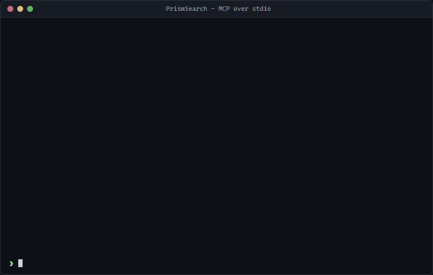
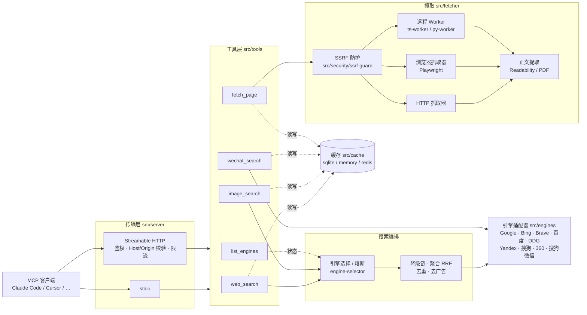

<p align="center">
  
</p>

<h1 align="center">PrismSearch</h1>

<p align="center">
  <a href="https://github.com/xiaonerner0821/prismsearch/actions/workflows/ci.yml"></a>
  <a href="https://www.npmjs.com/package/prismsearch"></a>
  <a href="https://codecov.io/gh/xiaonerner0821/prismsearch"></a>
  <a href="https://github.com/xiaonerner0821/prismsearch/actions/workflows/codeql.yml"></a>
  <a href="https://scorecard.dev/viewer/?uri=github.com/xiaonerner0821/prismsearch"></a>
  <a href="https://nodejs.org"></a>
  <a href="LICENSE"></a>
</p>

<p align="center">简体中文 | <strong><a href="README.md">English</a></strong></p>

多引擎网页搜索 MCP（Model Context Protocol）服务器，聚合多个搜索引擎的搜索结果。

如同棱镜将光分散为多色光谱，PrismSearch 将你的搜索请求分散到多个引擎，获取多角度的搜索结果。

### 为什么需要它：没有搜索账号也能联网搜索

Claude Code、DeepSeek Harness 等 AI 编程助手内置的联网搜索，通常依赖官方账号或单独配置的搜索服务 API Key。接入第三方模型、走自建网关，或者没有配置搜索账号时，内置搜索往往直接不可用，Agent 只能「闭卷」写代码。

PrismSearch 一条命令就能补上这项能力：

- **零账号、零 API Key 开箱即用**：默认启用的 Bing、百度等引擎直接抓取公开结果页，不需要注册任何服务；开启浏览器抓取（`fetcher.browser.enabled: true`，需 Playwright）后 Google 也无需 Key；有 Brave / Google API Key 时会自动用上，更稳定
- **不挑模型、不挑客户端**：标准 MCP 协议，Claude Code、DeepSeek Harness、Cursor、VS Code、Cline 等支持 MCP 的客户端都能用
- **不只是搜索**：`fetch_page` 读取网页 / PDF 正文（Markdown 输出，支持分段读取长文），`wechat_search` 搜微信公众号文章，补齐「搜到了但读不了」的另一半
- **国内网络友好**：百度、搜狗、360、微信等中文源开箱可用，某个引擎被墙或被限流时自动降级到下一个
- **结果干净**：自动去除搜索引擎插入的推广广告，详见下方「去广告」

```bash
# Claude Code
claude mcp add prismsearch -- npx -y prismsearch
```

<p align="center">
  
</p>

> [!WARNING]
> 抓取型引擎通过公开网页获取结果，请自行遵守各搜索引擎与目标网站的服务条款、robots 协议及所在地法律法规，并合理控制请求频率。
> 学习、研究建议不是 Apache-2.0 许可证的额外限制；本项目与各搜索引擎公司无关联。完整说明见文末[免责声明](#免责声明)。

## 特性

- **9 个搜索源**：Google、Bing、百度、Brave、DuckDuckGo、Yandex、搜狗、360 搜索，以及微信公众号文章——可扩展的引擎插件系统
- **5 个 MCP 工具**：`web_search`、`image_search`、`fetch_page`、`wechat_search`、`list_engines`
- **双传输模式**：stdio（本地）和 Streamable HTTP（远程）MCP 传输
- **智能引擎选择**：根据可用性、延迟、成功率和语言匹配自动选择最佳引擎，支持跨源降级
- **Google 三策略编排**：Custom Search API → 浏览器渲染 → 纯 HTTP，自动降级并记忆成功策略
- **搜索结果去广告**：自动剔除百度推广、Bing / Google / DuckDuckGo 赞助结果、360 / 搜狗推广位等广告，不占用返回条数；落地链接带付费投放追踪参数的漏网广告也会再过滤一遍
- **网页抓取**：抓取 URL 内容并转换为 HTML、纯文本或 Markdown；可选 Playwright 渲染应对 JS 重页面
- **图片搜索**：多引擎图片搜索，支持尺寸/类型过滤与 base64 缩略图
- **缓存机制**：可配置 TTL 与 LRU 淘汰，后端可选 `cache.backend: sqlite | memory | redis`（默认 SQLite）
- **安全防护**：SSRF 防护、速率限制、域名白/黑名单、远程模式可选 Bearer 鉴权
- **热更新**：配置文件监听，自动重载
- **灵活配置**：YAML/JSON/TOML 配置，支持环境变量覆盖

### 效果示例

一次 `web_search` 调用返回结构化、已去重的结果：

```json
{
  "results": [
    {
      "title": "Model Context Protocol - Introduction",
      "url": "https://modelcontextprotocol.io/introduction",
      "snippet": "The Model Context Protocol (MCP) is an open protocol that enables seamless integration between LLM applications and external data sources and tools.",
      "source": "brave",
      "position": 1
    }
  ],
  "totalResults": 10,
  "engine": "brave",
  "searchTime": 842,
  "cached": false,
  "page": 1,
  "hasMore": true
}
```

`results[]` 每项必有 `title`、`url`、`snippet`、`source`（来源引擎）、`position`，可能带 `timestamp`；`mode=aggregate` 时每项还带 `sources`，响应带 `engines`。所用引擎忽略了某些参数时响应带 `warnings`。同样的 JSON 既放在 `structuredContent`，也以文本形式放在 `content` 中。

### 架构



stdio 模式只有一个客户端，限流在工具层执行；HTTP 模式在传输层按客户端分桶限流。`fetch_page` 的 Worker 委派由 `workers.useFor` 决定，所有 Worker 不可用时回落到本地抓取器；Worker 返回的最终地址会再经过一次 SSRF 校验。

## 环境要求

- **Node.js ≥ 22.19**
- 原生模块 `better-sqlite3` 为主流平台（Windows/macOS/Linux，x64/arm64）提供预编译二进制；若你的平台没有预编译包，则需要 C++ 编译工具链
- **可选**：[Playwright](https://playwright.dev) 浏览器渲染。它是 `optionalDependencies`——默认会安装（安装时自动下载浏览器）；极简安装可用 `npm install --omit=optional`。事后补装：`npm install playwright && npx playwright install chromium`

## 快速开始

### 安装

```bash
npm install prismsearch
```

### 在 Claude Code 中使用

```bash
claude mcp add prismsearch -- npx -y prismsearch
```

或在 MCP 设置中添加：

```json
{
  "mcpServers": {
    "prismsearch": {
      "command": "npx",
      "args": ["-y", "prismsearch"],
      "env": { "BRAVE_API_KEY": "可选" }
    }
  }
}
```

### 其他客户端

| 客户端 | 配置位置 | 写法 |
| --- | --- | --- |
| Claude Desktop | `claude_desktop_config.json` | 同上 `mcpServers` 片段 |
| Cursor | `~/.cursor/mcp.json` 或项目内 `.cursor/mcp.json` | 同上 `mcpServers` 片段 |
| VS Code（Copilot） | `.vscode/mcp.json` | 顶层键改为 `"servers"`，并加 `"type": "stdio"` |
| Windsurf / Cline 等 | 各自的 MCP 配置文件 | 通用 `command` + `args` 写法 |
| 远程（HTTP） | 支持 Streamable HTTP 的客户端 | URL 填 `http://host:3000/mcp`，请求头带 `Authorization: Bearer <token>` |

Windows 上如果客户端找不到 `npx`，把 `command` 改为 `"cmd"`，`args` 改为 `["/c", "npx", "-y", "prismsearch"]`。

### 作为 Agent Skill 使用

[`skills/prismsearch/SKILL.md`](skills/prismsearch/SKILL.md) 是一个 [Agent Skill](https://agentskills.io)，告诉 agent 每个工具什么时候用：先搜索再读原文、何时用 `timeRange` 和 `aggregate` 模式、抓取失败时改用浏览器渲染、长文分段读取、引擎失败时如何处理。它只提供使用指引，仍需先按上文连接 MCP 服务器。

在 Claude Code 中安装，把整个目录复制到 skills 目录即可：

```bash
# 对所有项目生效
cp -r skills/prismsearch ~/.claude/skills/
# 只对当前项目生效
cp -r skills/prismsearch .claude/skills/
```

其他支持 Agent Skills 格式的 agent 也可以直接加载这个目录。

### 引擎能力一览

| 引擎 | 网页 | 图片 | 方式 | 默认 | 说明 |
| --- | --- | --- | --- | --- | --- |
| Google | ✅ | ✅ | API / 浏览器渲染 / HTTP | 开启 | 配置 Custom Search API 最稳定；纯 HTTP 常被 JS 墙拦截 |
| Bing | ✅ | ✅ | HTTP 抓取 | 开启 | |
| Brave | ✅ | ✅ | 官方 API | 开启 | 需要 `BRAVE_API_KEY`，未配置时自动跳过 |
| 百度 | ✅ | ✅ | HTTP 抓取 / JSON 接口 | 开启 | 中文内容 |
| DuckDuckGo | ✅ | — | HTTP 抓取 | 关闭 | 频繁请求会触发人机验证 |
| Yandex | ✅ | — | HTTP 抓取 | 关闭 | |
| 搜狗 | ✅ | — | HTTP 抓取 | 关闭 | 中文内容 |
| 360 搜索 | ✅ | — | HTTP 抓取 | 关闭 | 中文内容 |

#### 各引擎参数支持（网页搜索）

`web_search` 的各参数在不同引擎上如何映射。「—」表示该引擎没有对应参数：传了不报错，但结果的 `warnings` 会说明哪些参数被忽略；`list_engines` 返回的 `capabilities` 字段也声明了每个引擎支持哪些参数。

| 引擎 | `region` | `language` | `safeSearch` | `timeRange` | `page` | `count` |
| --- | --- | --- | --- | --- | --- | --- |
| Google（抓取） | `gl` | `hl` | `safe=active` | `tbs=qdr:d/w/m/y` | `start` 偏移 | `num` |
| Google（Custom Search API） | `gl` | `hl` | `safe=active/off` | `dateRestrict` | `start` 偏移，总计最多 100 条 | 单次最多 10 条，超出时自动连续请求多页 |
| Bing | `cc`（国家码，`uk` → `GB`）+ `mkt`（市场） | `setlang` | `adlt=strict` | `filters=ex1:"ez1/ez2/ez3"`，年为自定义区间 | `first` 偏移（按实际返回条数推进） | 每页约 10 条，超出时自动连续请求多页拼接 |
| Brave | `country`（`uk` → `GB`） | `search_lang` | `safesearch=strict/moderate` | `freshness=pd/pw/pm/py` | `offset`，最多 10 页 | 单次最多 20 条，超出时自动连续请求多页 |
| 百度 | — | — | — | `gpc=stf=…`（时间区间） | `pn` 偏移 | `rn` |
| DuckDuckGo | `kl`（区域 + 语言，如 `us-en`） | 参与拼 `kl` 与 `Accept-Language` | `kp=1` | `df=d/w/m/y` | `s` 偏移 | 本地截断 |
| Yandex | `lr`（地区 ID） | `lang` | — | — | `p`（从 0 开始） | `numdoc` |
| 搜狗 | — | — | — | `s_from=inttime_*` | `page` | 固定每页 10 条，本地截断 |
| 360 搜索 | — | — | — | `adv_t=d/w/m/y` | `pn` | 固定每页 10 条，本地截断 |

图片搜索：Google（`gl` / `hl` / `safe`，尺寸与类型走 `tbs`）、Bing（`setlang`、`safesearch=strict`，尺寸与类型走 `qft`）、Brave（`country` / `search_lang` / `safesearch`；接口本身不支持分页，按页从最多 200 条中切片）、百度（尺寸走 `z`，GIF 走 `ic`；不支持区域 / 语言 / 安全搜索）。

第 1 页会多取几条结果，保证去重后仍能凑满 `count`；自动选引擎时，后续翻页会沿用第 1 页实际使用的引擎，避免结果在不同引擎之间跳来跳去。

微信公众号是独立的 `wechat` 配置段（不是普通引擎），由 `wechat_search` 工具提供；返回的链接有时效。

抓取型引擎依赖页面结构，搜索引擎改版时可能短暂失效；项目每天运行联网冒烟测试来及早发现。

### HTTP 传输模式

```bash
# 使用随包附带的 HTTP 示例配置启动
npx prismsearch config/http.yaml

# 或使用环境变量
PRISMSEARCH_SERVER_TRANSPORT=http PRISMSEARCH_SERVER_PORT=3000 npx prismsearch
```

HTTP 端点为 `http://127.0.0.1:3000/mcp`（健康检查在 `/health`）。对外暴露时请务必开启鉴权：设置 `PRISMSEARCH_AUTH_TOKENS` 或在配置中启用 `security.auth`。

### CLI

```bash
prismsearch [配置文件]     # 启动服务；位置参数是配置文件路径（YAML / JSON / TOML），可省略
prismsearch --help         # 中英双语帮助，含常用环境变量（-h）
prismsearch --version      # 输出版本号（-v）
```

位置参数的优先级最高，高于 `PRISMSEARCH_CONFIG` 与默认查找路径（见「配置」）。指定的文件不存在时直接报错退出。传输方式、端口等不通过命令行参数设置，而是写在配置文件里或用环境变量（见「环境变量」）。CLI 刻意保持为轻量启动器：不提供浏览器界面、托管搜索账号或独立 Web 控制台；请通过支持 MCP 的客户端（或 HTTP 传输）调用工具。

npm 包只提供这个 CLI / MCP Server，不是 JavaScript 库。请不要 `import 'prismsearch'`，也不要深层导入 `dist/` 下的文件：导入入口会直接启动服务，内部模块在任何版本都可能变化。对外承诺稳定、随版本号演进的接口只有 MCP 工具 schema、配置文件和 [Worker 协议](docs/worker-protocol.md)；扩展抓取能力请实现 Worker，新增引擎请向上游贡献或 fork。

### 隐私与本地数据

PrismSearch 不是托管数据服务。默认本地 stdio 模式下，请求和响应经过本机进程；缓存默认写入本地 SQLite，日志默认写入本地进程的 stderr。启用远程 HTTP、第三方 API、浏览器抓取、代理、Redis 或 Worker 后，查询文本、URL、请求头和抓取内容可能发送给相应提供商或服务。请查看其隐私政策，并为部署配置保留期限、访问控制和 `log.redact`。除非已核实请求链路中的每项服务，否则不要提交密码、私密令牌、个人数据或机密内容。

### 条款、版权与服务访问

搜索摘要、图片、网页、PDF 和微信公众号文章由第三方提供，可能受版权或其他权利保护。PrismSearch 不授予复制、存储、展示、抓取或再分发第三方内容的权利。你应自行负责获得许可、保留署名、遵守 robots 指令、适用法律、各服务条款及合理限流。Apache-2.0 仅许可本仓库代码，不授予任何搜索服务的访问权，不允许绕过鉴权或反爬控制，也不许可第三方商标或内容。


## MCP 工具

### web_search

使用多个搜索引擎进行网页搜索（Google、Bing、百度、360、搜狗、DuckDuckGo、Yandex、Brave）。

**参数：**
| 参数 | 类型 | 必填 | 默认值 | 说明 |
|------|------|------|--------|------|
| query | string | 是 | - | 搜索关键词，去掉首尾空白后 1-500 个字符 |
| engine | string | 否 | 自动 | 搜索引擎：`google`、`bing`、`baidu`、`so`、`sogou`、`duckduckgo`、`yandex`、`brave`；不填则自动选择并降级 |
| region | string | 否 | - | 搜索区域代码（如 `cn`、`us`、`hk`），最长 10 个字符 |
| language | string | 否 | - | 语言代码（如 `zh-CN`、`en`），最长 20 个字符 |
| count | integer | 否 | 10 | 返回结果数量，1-50 |
| page | integer | 否 | 1 | 页码，1-10 |
| safeSearch | boolean | 否 | false | 是否开启安全搜索 |
| timeRange | string | 否 | - | 时间范围：`day`、`week`、`month`、`year`；自动选引擎时优先使用支持时间过滤的引擎 |
| mode | string | 否 | fallback | `fallback`：单引擎，失败自动降级；`aggregate`：并发查询排名前 3 的可用引擎，按倒数排名融合（RRF）合并去重，每条结果带 `sources`，响应带 `engines` |

客户端在请求的 `_meta.progressToken` 里要求进度时，每尝试 / 启动一个引擎都会发送一次 `notifications/progress`。

### image_search

使用多个搜索引擎进行图片搜索（Google、Bing、百度、Brave）。

**参数：**
| 参数 | 类型 | 必填 | 默认值 | 说明 |
|------|------|------|--------|------|
| query | string | 是 | - | 搜索关键词，去掉首尾空白后 1-500 个字符 |
| engine | string | 否 | 自动 | 支持图片搜索的引擎：`google`、`bing`、`brave`、`baidu`；不填则自动选择并降级 |
| region | string | 否 | - | 搜索区域代码，最长 10 个字符 |
| language | string | 否 | - | 语言代码，最长 20 个字符 |
| count | integer | 否 | 10 | 返回结果数量，1-50 |
| page | integer | 否 | 1 | 页码，1-10 |
| safeSearch | boolean | 否 | false | 是否开启安全搜索 |
| imageSize | string | 否 | - | 按尺寸过滤：`small`、`medium`、`large` |
| imageType | string | 否 | - | 按类型过滤：`photo`、`clipart`、`gif`、`transparent` |
| includeThumbnails | boolean | 否 | false | 是否在结果中内联 base64 缩略图（最多 20 张，每张不超过 50KB） |

每条结果包含 `title`、`imageUrl`、`thumbnailUrl`、`sourceUrl`、`position`、`source`，可能带 `sourceTitle`、`width`、`height`、`thumbnailBase64`；响应同样带 `engine`、`searchTime`、`cached`、`page`、`hasMore`。

### fetch_page

抓取指定 URL 的网页内容。

**参数：**
| 参数 | 类型 | 必填 | 默认值 | 说明 |
|------|------|------|--------|------|
| url | string | 是 | - | 要抓取的网页 URL，仅 http/https，最长 4096 个字符 |
| format | string | 否 | markdown | 返回格式：`html`、`text`、`markdown` |
| timeout | integer | 否 | 30000（`fetcher.timeout`） | 总超时（毫秒），1000-120000，所有降级 / 重抓尝试共用 |
| method | string | 否 | http（`fetcher.defaultMethod`） | 抓取方式：`http` 或 `browser`（Playwright，用于 JS 渲染页面）。未指定时，若 `http` 结果像 JS 骨架页或反爬挑战页且浏览器可用，自动改用浏览器重抓；显式 `http` 不升级；`browser` 在 Playwright 不可用时退回 `http` 并给出 warning |
| waitForSelector | string | 否 | - | 仅浏览器抓取：提取前等待出现的 CSS 选择器，最长 500 个字符；等不到时返回当前已渲染的内容 |
| maxLength | integer | 否 | 20000 | 本次最多返回的正文字符数，100-1000000；超出时返回 `truncated: true` 与 `nextStartIndex` |
| startIndex | integer | 否 | 0 | 从正文第几个字符开始返回（≥ 0），配合 `nextStartIndex` 分段续读（命中同一份缓存，不重复抓取） |

返回的 `totalLength` 是完整正文长度；`bodyTruncated` 表示响应体超过 `fetcher.maxBytes`，只抓到了开头。`format=html` 时 HTML 只在 `content` 中返回一份。

正文提取优先使用 Mozilla Readability（`@mozilla/readability` + `linkedom`），识别不出正文时回退到内置启发式。PDF 会提取文本层（`unpdf`，最多前 50 页）；扫描件没有文本层时给出 warning。所有目标地址都先经过 SSRF 防护校验（见「安全」）。

### wechat_search

基于搜狗微信搜索公众号文章。返回文章标题、公众号名称、发布日期、摘要和带签名的临时文章链接。

**注意事项：**
- 文章链接是**带签名的临时链接**（通常几小时内有效），需要正文请尽快用 `fetch_page` 抓取
- 结果仅缓存 10 分钟（短于普通搜索，避免链接过期）
- 搜狗有频率限制，引擎内置 Cookie 轮换与重试退避

**参数：**
| 参数 | 类型 | 必填 | 默认值 | 说明 |
|------|------|------|--------|------|
| query | string | 是 | - | 搜索关键词（中文效果最佳），去掉首尾空白后 1-200 个字符 |
| count | integer | 否 | 10 | 返回结果数量，1-10 |
| page | integer | 否 | 1 | 页码，1-10 |

### list_engines

列出所有已注册的搜索引擎及其当前状态（可用性、延迟、支持的特性）。无参数。

## 配置

PrismSearch 按以下顺序查找配置文件，使用找到的第一个：
1. 命令行参数指定的路径（`npx prismsearch ./my-config.yaml`）
2. 环境变量 `PRISMSEARCH_CONFIG`
3. 当前工作目录下的 `./prismsearch.{yaml,yml,json,toml}`
4. `~/.prismsearch/config.{yaml,yml,json,toml}`（设置了 `PRISMSEARCH_HOME` 时以它为目录）

都找不到时使用内置默认值。环境变量覆盖在最终选中的配置之上生效。

[config/default.yaml](config/default.yaml) 是带注释的完整配置参考，**不会被自动加载**——请复制到上述任一位置（或用 `PRISMSEARCH_CONFIG` 指向它），只保留需要修改的项。

**启用更多引擎**：默认仅启用 Google、Bing、Brave、百度。DuckDuckGo、Yandex、搜狗、360 搜索已在 [config/default.yaml](config/default.yaml) 中列出并设为 `enabled: false`——在你自己的配置里改成 `true` 即可（或使用环境变量，如 `PRISMSEARCH_ENGINES__DUCKDUCKGO__ENABLED=true`）。

**搜索总时长上限**：`search.deadlineMs`（默认 `45000`）限制单次 `web_search` / `image_search` 整条降级链的总耗时，到点后不再尝试后续引擎，避免多个引擎依次超时让客户端长时间挂起。客户端取消请求时，正在进行的上游请求也会一并中止。

**去广告**：搜索结果分两层去广告。① 引擎解析时按页面上的广告标记（推广标签、广告专用的 class / 属性、广告区块）直接跳过，始终生效；② 工具层再按落地链接过滤漏网广告（广告点击跳转域名，以及 `sdclkid`、`gclid`、`msclkid`、`utm_medium=cpc/ppc/sem` 等付费投放追踪参数）。第 ② 层可用 `search.adFilter: false`（或环境变量 `PRISMSEARCH_SEARCH__ADFILTER=false`）关闭。百度「爱采购」「惠生活」等百度自营卡片不属于广告，会保留。

**引擎亲和**：请求带 `region` / `language` 时，选择器优先挑擅长对应区域 / 语言的引擎。每个引擎可用 `regions`、`languages` 覆盖内置默认（如百度为 `cn/hk/tw` 与中文系语言）；留空沿用内置值，写了则整体替换，区域匹配不区分大小写。

### Google 搜索配置

自 2025 年起，Google 搜索结果页强制要求 JavaScript 渲染——纯 HTTP 抓取只会收到"请启用 JavaScript"的拦截页。
PrismSearch 的 Google 引擎支持三种策略，按顺序自动降级并记忆成功策略：
**Custom Search API → 浏览器渲染 → 纯 HTTP**。

**方式 A：浏览器渲染（Playwright）**

```bash
npm install playwright
npx playwright install chromium
```

然后在配置中启用浏览器抓取器：

```yaml
fetcher:
  browser:
    enabled: true
    browserType: chromium
```

**方式 B：Google Custom Search API（推荐，最稳定）**

免费额度：每个 API Key 每天 100 次查询。需要两个凭据：

| 凭据 | 配置字段 | 环境变量 |
|------|----------|----------|
| API Key | `engines[].apiKey`（逗号分隔多个可轮换） | `GOOGLE_API_KEY` |
| 搜索引擎 ID（cx） | `engines[].searchEngineId` | `GOOGLE_CSE_ID` |

获取步骤：

1. 打开 [Google Cloud Console](https://console.cloud.google.com/)，创建或选择一个项目。
2. 进入 **API 和服务 → 库**，搜索 **Custom Search API**，点击**启用**。
3. 进入 **API 和服务 → 凭据 → 创建凭据 → API 密钥**。
   （建议：将该密钥的应用限制设为仅"Custom Search API"。）
4. 打开 [Programmable Search Engine](https://programmablesearchengine.google.com/)，
   点击**添加**，选择**搜索整个网络**，复制**搜索引擎 ID**（cx）。
5. 通过环境变量注入凭据（**推荐——切勿把密钥提交进版本库**）：

```bash
# Windows（持久化）
setx GOOGLE_API_KEY "AIza..."
setx GOOGLE_CSE_ID "0123456789abcdef0"

# macOS / Linux
export GOOGLE_API_KEY="AIza..."
export GOOGLE_CSE_ID="0123456789abcdef0"
```

两种方式同时可用时优先走 API；配额耗尽（429/403）时自动降级到浏览器渲染。

可以端到端验证配置是否生效：

```bash
npm run build
node scripts/dev/verify-google-e2e.mjs "openai"
```

### Brave 搜索配置

Brave 提供免费 API 额度（每月 2000 次查询、无需绑卡）。
到 <https://brave.com/search/api/> 注册，然后：

```bash
# Windows
setx BRAVE_API_KEY "BSA..."
# macOS / Linux
export BRAVE_API_KEY="BSA..."
```

支持逗号分隔配置多个 Key，配额耗尽时自动轮换。

### 环境变量

环境变量在配置文件之上生效（优先级：内置默认值 < 配置文件 < 环境变量）。

| 变量 | 说明 |
| --- | --- |
| `PRISMSEARCH_CONFIG` | 配置文件路径（YAML / JSON / TOML）；命令行位置参数优先于它 |
| `PRISMSEARCH_HOME` | 数据目录，默认 `~/.prismsearch`；默认缓存库 `cache.db` 与用户配置 `config.*` 都放在这里 |
| `PRISMSEARCH_AUTH_TOKENS` | 逗号分隔的访问令牌；**非空时自动开启 `security.auth`**，HTTP 客户端需带 `Authorization: Bearer <token>` |
| `PRISMSEARCH_WORKER_TOKEN` | 抓取 Worker 共享令牌；`workers.endpoints[].token` 留空时使用它，Worker 端也读同名变量 |
| `GOOGLE_API_KEY` / `GOOGLE_CSE_ID` | Google Custom Search API 的 Key（逗号分隔可轮换）与搜索引擎 ID（cx） |
| `BRAVE_API_KEY` | Brave Search API Key（逗号分隔可轮换）；未配置时 Brave 自动跳过 |
| `PRISMSEARCH_SERVER_TRANSPORT` | `stdio`（默认）\| `http` |
| `PRISMSEARCH_SERVER_PORT` / `PRISMSEARCH_SERVER_HOST` | HTTP 端口（默认 `3000`）与监听地址（默认 `127.0.0.1`） |
| `PRISMSEARCH_LOG_LEVEL` | `error` \| `warn` \| `info` \| `debug` |
| `PRISMSEARCH_<路径>` | 覆盖任意配置项，见下文 |

配置文件里写了非空的 `apiKey` / `searchEngineId` 时，它们优先于 `GOOGLE_*` / `BRAVE_API_KEY`；留空字符串视为未设置，仍读环境变量。

**任意配置项**都可以用 `PRISMSEARCH_` 前缀覆盖。推荐用**双下划线**分隔层级，层级内的单下划线会被忽略、字段名大小写不敏感，所以 `RATE_LIMIT` 与 `RATELIMIT` 都能匹配 `rateLimit`；`engines` 下一级写引擎名。也兼容单下划线的旧写法（`PRISMSEARCH_SERVER_PORT`），无法匹配到已有字段的变量会被忽略并给出启动警告。

```bash
PRISMSEARCH_SECURITY__RATE_LIMIT__MAX_REQUESTS=30      # security.rateLimit.maxRequests
PRISMSEARCH_ENGINES__BING__ENABLED=false               # 按引擎名覆盖 engines[name=bing].enabled
PRISMSEARCH_ENGINES__DUCKDUCKGO__ENABLED=true
PRISMSEARCH_CACHE__BACKEND=redis
PRISMSEARCH_CACHE__TTL=7200
PRISMSEARCH_FETCHER__BROWSER__ENABLED=true
# 数组：JSON 写法或逗号分隔
PRISMSEARCH_SECURITY__SSRF__WHITELIST='["intranet.example.com","*.corp.example"]'
PRISMSEARCH_SERVER__ALLOWED_HOSTS=search.example.com,localhost
```

取值按目标字段的类型转换：`true` / `false` 转布尔，数字转数值，数组字段接受 JSON 数组或逗号分隔。仓库根目录的 [.env.example](.env.example) 列出了常用变量。

## 抓取 Worker（可选）

Worker 是可选的抓取后端，不是 MCP Server，也不是额外的搜索引擎。MCP 客户端只连接主服务；不要把 Worker URL 配置为 MCP 端点，也不要公开暴露 Worker 端口。委派会跨越信任边界：Worker 运营者可能看到请求 URL、附加请求头和抓取内容。只使用可信 Worker，跨主机时使用私有网络或 TLS，并设置独立的 Worker token；启用本地降级后，流量也可能回到主服务所在网络。

部分页面强制 JS 渲染，或者会识别 TLS 指纹。遇到这类页面时，可以把抓取请求委派给独立部署的 Worker。两种 Worker 使用同一套 HTTP + JSON 协议（详见 [docs/worker-protocol.md](docs/worker-protocol.md)），主服务据此做负载均衡、健康检查和故障转移；所有 Worker 都不可用时，会自动回落到本地抓取。

| Worker | 能力 | 适用场景 |
| --- | --- | --- |
| [`workers/ts-worker`](workers/ts-worker/) | `http` + `browser`（Playwright） | 强制 JS 渲染、验证码前置页 |
| [`workers/py-worker`](workers/py-worker/) | `http`（curl_cffi + trafilatura） | 指纹识别型反爬、高质量正文提取 |

```bash
# 一键启动主服务 + 两个 Worker（必须设置两个令牌）
export PRISMSEARCH_AUTH_TOKENS=<主服务访问令牌>
export PRISMSEARCH_WORKER_TOKEN=<Worker 共享令牌>
export PRISMSEARCH_WORKERS_ENABLED=true
docker compose -f docker/docker-compose.yml --profile with-workers up -d --build
```

profile 只决定启动哪些容器；主服务是否委派由 `PRISMSEARCH_WORKERS_ENABLED=true` 打开（compose 已配好两个 Worker 端点）。不用 compose 时，在配置里启用：

```yaml
workers:
  enabled: true
  strategy: least-busy     # 或 round-robin（平滑加权轮询）
  useFor: browser          # browser：仅渲染请求委派；always：全部委派
  fallbackToLocal: true
  endpoints:
    - { name: ts-1, url: http://ts-worker:8787, weight: 100 }
    - { name: py-1, url: http://py-worker:8788, weight: 50 }
```

Worker 未配置令牌时只会监听回环地址，不会在网络上裸奔。

## Docker

发布时会构建三个多架构（amd64 / arm64）镜像：

| 镜像 | 内容 |
| --- | --- |
| `ghcr.io/xiaonerner0821/prismsearch` | 主服务（HTTP 模式，端口 3000） |
| `ghcr.io/xiaonerner0821/prismsearch-ts-worker` | 浏览器渲染 Worker（Playwright，端口 8787） |
| `ghcr.io/xiaonerner0821/prismsearch-py-worker` | 指纹伪装 Worker（curl_cffi + trafilatura，端口 8788） |

单独运行主服务：

```bash
docker run -d -p 127.0.0.1:3000:3000 \
  -e PRISMSEARCH_AUTH_TOKENS=<访问令牌> \
  ghcr.io/xiaonerner0821/prismsearch:latest
```

- 镜像默认以 HTTP 模式监听容器内的 `0.0.0.0`，因此**必须设置 `PRISMSEARCH_AUTH_TOKENS`**，否则服务拒绝启动；客户端请求时带 `Authorization: Bearer <访问令牌>`
- 上例把端口只发布到宿主机的 `127.0.0.1`；需要对外提供服务时请放在反向代理（TLS）之后
- 数据目录是 `/app/data`（`PRISMSEARCH_HOME`），需要持久化缓存时挂载卷；要加载自己的配置文件，挂载后用 `PRISMSEARCH_CONFIG` 指向它
- **主服务镜像不含浏览器**（不装 Playwright，`fetcher.browser` 默认关闭）。需要 JS 渲染时请启用 ts-worker，并在配置里开启 `workers`（见上一节）

用 compose 启动（在仓库根目录执行）：

```bash
export PRISMSEARCH_AUTH_TOKENS=<访问令牌>
docker compose -f docker/docker-compose.yml up -d

# 同时启动两个 Worker 并委派抓取（还需要 PRISMSEARCH_WORKER_TOKEN）
export PRISMSEARCH_WORKER_TOKEN=<Worker 共享令牌>
PRISMSEARCH_WORKERS_ENABLED=true docker compose -f docker/docker-compose.yml --profile with-workers up -d

# 使用 Redis 缓存（必须设置密码，否则 redis 容器拒绝启动）
export PRISMSEARCH_REDIS_PASSWORD=<随机长字符串>
PRISMSEARCH_CACHE_BACKEND=redis docker compose -f docker/docker-compose.yml --profile with-redis up -d
```

两个 profile 可以同时使用。compose 各服务的具体参数见 [docker/docker-compose.yml](docker/docker-compose.yml) 中的注释。

## 安全

- **鉴权**：HTTP 模式监听非回环地址时必须开启鉴权（Bearer Token 或 `X-API-Key`），否则拒绝启动；令牌用常量时间比较
- **Host / Origin 校验**：防 DNS 重绑定与跨站请求，可用 `server.allowedHosts` / `server.allowedOrigins` 放行
- **限流**：HTTP 模式按客户端分桶（凭证指纹或地址），stdio 模式在工具层限流
- **SSRF 防护**：`fetch_page` 与 Worker 只允许 http/https，拦截内网、回环、链路本地等保留地址，建连时再次校验解析结果（防 DNS 重绑定），重定向逐跳校验
- **错误与日志**：返回给客户端的错误按白名单透传，内部细节只写日志；日志默认脱敏查询串与搜索词

漏洞报告方式见 [SECURITY.md](SECURITY.md)。

### SSRF 白名单说明

`security.ssrf.whitelist` 仅允许明确配置的主机名，不会绕过 IP 校验。若要访问内网目标，请使用精确主机名配置 `security.ssrf.allowedPrivateHosts`（不支持通配符），并审查网络边界。Worker 来源还必须加入精确的 `workers.allowedOrigins`（不带末尾斜杠）、设置 token；非回环来源必须使用 HTTPS，除非显式启用本地/内网 HTTP 例外。因此：

- 只添加确实需要且 DNS 由你控制的域名，不要添加公共域名或过宽通配符
- `security.ssrf.blacklist` 优先于白名单
- 白名单只匹配主机名；直接写 IP 的 URL 仍按 IP 规则校验
- Worker 的 `allowedOrigins` 必须是精确 origin 且不带末尾斜杠；非回环来源必须设置 token 并使用 HTTPS

## 开发

```bash
# 安装依赖
npm install

# 构建
npm run build

# 开发模式
npm run dev

# 单元测试（离线）
npm test

# 运行测试（含覆盖率，带最低门槛）
npm run test:coverage

# 真实联网冒烟测试（访问真实搜索引擎，默认不跑）
npm run test:live

# 代码检查与类型检查
npm run lint
npm run typecheck

# Worker 测试
npm run test:worker                    # TS Worker
npm run test:worker:py                 # Python Worker（需先建 venv，见贡献指南）

# 发布前自检：构建 + 产物 / 版本 / 必需文件 / stdio 握手
npm run selfcheck
```

可选的端到端验证脚本在 `scripts/dev/`（基于编译产物、会真实访问搜索引擎），用法见[贡献指南](.github/CONTRIBUTING.zh-CN.md#开发验证脚本)。

## 项目结构

```
prismsearch/
├── src/
│   ├── index.ts              # 入口文件
│   ├── version.ts            # 版本号唯一来源（读取 package.json）
│   ├── server/               # MCP 服务器与传输层（stdio / Streamable HTTP）
│   ├── tools/                # MCP 工具实现（5 个工具）
│   ├── engines/              # 搜索引擎提供者（google/bing/baidu/brave/
│   │                         #   duckduckgo/yandex/so/sogou/wechat）
│   ├── fetcher/              # HTTP 与浏览器（Playwright）抓取器、内容提取
│   ├── workers/              # 抓取 Worker 客户端（负载均衡、健康检查、故障转移）
│   ├── cache/                # 缓存层（SQLite / Redis / 内存）
│   ├── config/               # 配置系统（YAML/JSON/TOML + 环境变量覆盖 + 热重载）
│   ├── security/             # SSRF 防护、速率限制、鉴权、内容过滤
│   └── utils/                # 日志、去重、API Key 轮换、代理池
├── config/                   # 默认配置与示例配置
├── docker/                   # Dockerfile 与 docker-compose
├── docs/                     # 协议与设计文档
├── scripts/                  # 版本 / 自检脚本；dev/ 下为开发验证脚本（见贡献指南）
├── tests/                    # 单元测试与集成测试
└── workers/                  # 可选的远程抓取 Worker
    ├── ts-worker/            #   Playwright 浏览器渲染（Node）
    └── py-worker/            #   curl_cffi 指纹伪装 + trafilatura（Python）
```

## 路线图

- [ ] WebSocket 长连接传输
- [x] ~~图片搜索支持~~（v0.3.1）
- [x] ~~Headless Browser 抓取器（Playwright）~~（v0.3.1）
- [x] ~~Docker 部署~~（v0.3.1）
- [x] ~~API Key 管理与轮换~~（v0.3.1）
- [x] ~~远程模式鉴权~~（v0.3.1）
- [x] ~~Redis 缓存后端~~（v0.3.1）
- [x] ~~远程抓取 Worker（浏览器渲染 / 指纹伪装）~~（v0.3.1）
- [x] ~~Worker 负载均衡与故障转移~~（v0.3.1）
- [x] ~~内容安全过滤~~（v0.3.1）

## 常见问题

**Google 总是失败或返回 0 条结果？**
Google 自 2025 年起要求 JS 渲染搜索结果页，纯 HTTP 抓取基本拿不到结果。可以选择：配置 `GOOGLE_API_KEY` + `GOOGLE_CSE_ID` 走官方 API（最稳定）；或开启 `fetcher.browser`、安装 Playwright；或启用 ts-worker 委派渲染。其余情况会自动降级到其他引擎。

**提示被限流（429）或出现验证码？**
抓取型引擎对高频请求敏感。可以调低引擎级 `rateLimit`、配置代理池（`fetcher.proxy`），或优先使用 Brave / Google 官方 API。缓存默认开启，重复查询不会再访问搜索引擎。

**用 `0.0.0.0` 启动 HTTP 模式时直接退出？**
这是有意的保护：监听非回环地址时必须开启鉴权。设置 `PRISMSEARCH_AUTH_TOKENS` 即可，客户端请求时带上 `Authorization: Bearer <token>`。

**`npm install` 时 better-sqlite3 编译失败？**
通常是平台没有预编译包且缺少编译工具链。可以安装构建工具，或把 `cache.backend` 改为 `memory` / `redis`。

**缓存和日志存在哪里？**
缓存默认在 `~/.prismsearch/cache.db`（可用 `PRISMSEARCH_HOME` 或 `cache.sqlite.path` 修改）；日志默认输出到 stderr，不会污染 stdio 协议。

**怎么确认实际加载了哪个配置文件？**
运行 `npm run build && node scripts/check-cwd-config.mjs`。它会打印实际生效的配置文件、按优先级排列的全部候选路径、已启用引擎，以及各 API Key 是否配置（不显示内容）。排查「我明明写了配置却没生效」时先跑这个。

## 免责声明

PrismSearch 采用 Apache-2.0，可依该许可证使用、修改与再分发。项目建议优先用于学习、研究与个人用途，但这不是额外的许可证限制。抓取型引擎通过公开网页获取结果，使用者应自行遵守各搜索引擎与目标网站的服务条款、robots 协议、版权与隐私规则、所在地法律法规，并合理控制请求频率。本项目与 Google、Microsoft、Brave、百度、搜狗、360、Yandex、DuckDuckGo、腾讯等公司无任何关联，相关商标归其各自所有者所有。许可证仅覆盖本仓库代码，不授予第三方内容、商标或服务访问权；因使用本项目产生的任何后果由使用者自行承担。

部署、反向代理、资源限额、健康/指标、数据清理和维护者交接请参阅[运维手册](docs/OPERATIONS.md)；依赖与第三方许可边界请参阅[第三方说明](docs/THIRD-PARTY-NOTICES.md)。

## 参与贡献

欢迎贡献！开发环境搭建、分支/提交规范、以及如何添加新搜索引擎的完整步骤，请参阅
[贡献指南](.github/CONTRIBUTING.zh-CN.md)（[English](.github/CONTRIBUTING.md)）。参与本项目即表示你同意遵守[行为准则](CODE_OF_CONDUCT.md)。

使用中遇到问题？请看[获取帮助](.github/SUPPORT.md)：使用问题去 Discussions，Bug 去 Issues。

发现安全问题？请按 [SECURITY.md](SECURITY.md) 私下报告。

## 许可证

[Apache License 2.0](LICENSE)——另见 [NOTICE](NOTICE)。
